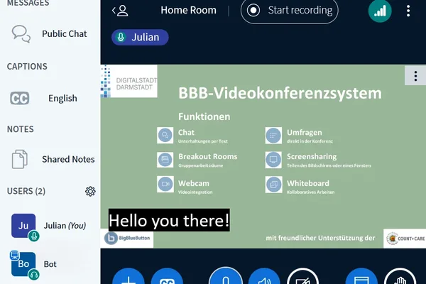
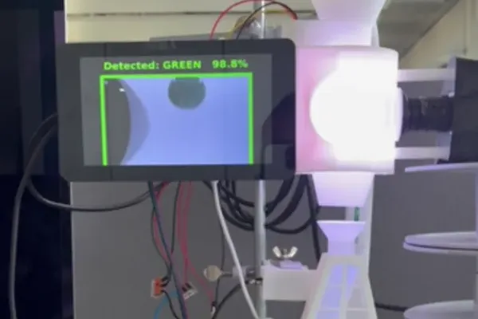
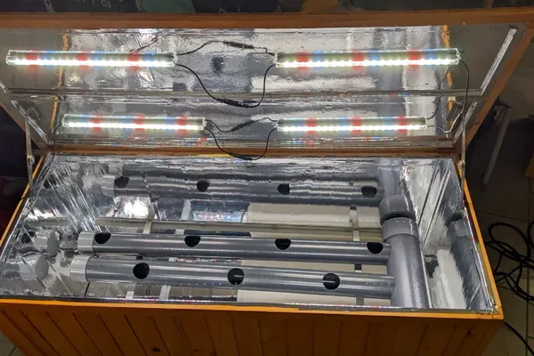
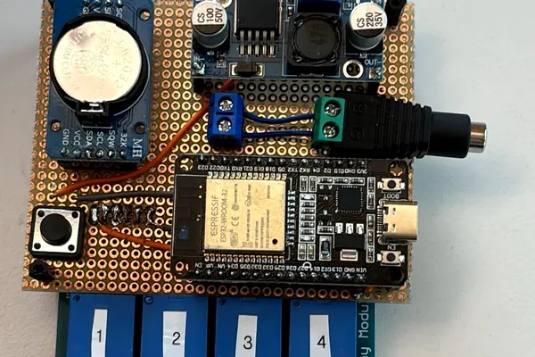
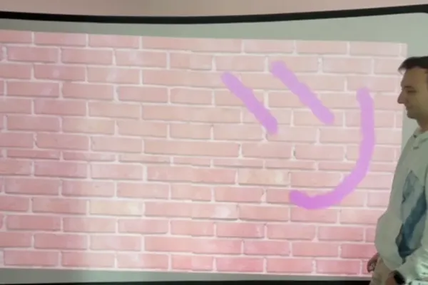
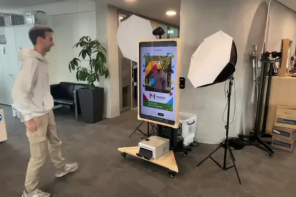

# Hi, I'm Julian 👋

**IT & Innovation. Software, hardware, AI: I connect what belongs together.**

Computer scientist (B.Sc., Hochschule Darmstadt) from the Frankfurt/Rhine-Main area.
I build things where AI, software and hardware meet, and that actually run in the end:
Linux infrastructure, IoT, real-time speech transcription and digital twins.

🌐 **[julian.kropp.link](https://julian.kropp.link)** – projects, CV and contact

 

### Some projects

<table>
  <tr>
    <td width="33%" valign="top">
      
      <b><a href="https://github.com/bigbluebutton-bot">BBB Translation Bot</a></b> 
      Live captions and translation for video conferences
    </td>
    <td width="33%" valign="top">
      
      <b><a href="https://github.com/ITLab-CC/Sorter">AI Sorter</a></b> 
      Camera-based marble sorter with a digital twin
    </td>
    <td width="33%" valign="top">
      
      <b><a href="https://julian.kropp.link/#growbox">Smart GrowBox</a></b> 
      Hydroponics with sensors and a web portal
    </td>
  </tr>
  <tr>
    <td width="33%" valign="top">
      
      <b><a href="https://github.com/JulianKropp/smart-relay">Smart Relays</a></b> 
      Custom PCB and firmware
    </td>
    <td width="33%" valign="top">
      
      <b><a href="https://github.com/ITLab-CC/Virtual-Graffiti">Virtual Graffiti</a></b> 
      Spray on a wall without any paint
    </td>
    <td width="33%" valign="top">
      
      <b><a href="https://github.com/ITLab-CC/photobooth">Photo Booth</a></b> 
      Self-built, at every party
    </td>
  </tr>
</table>

### Tools I use

  

